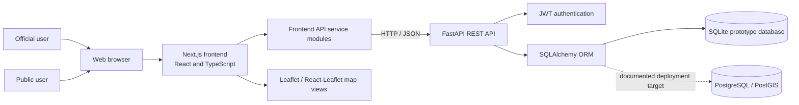
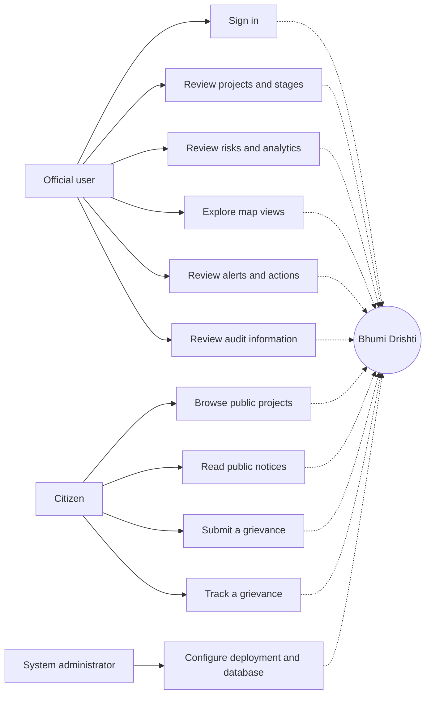
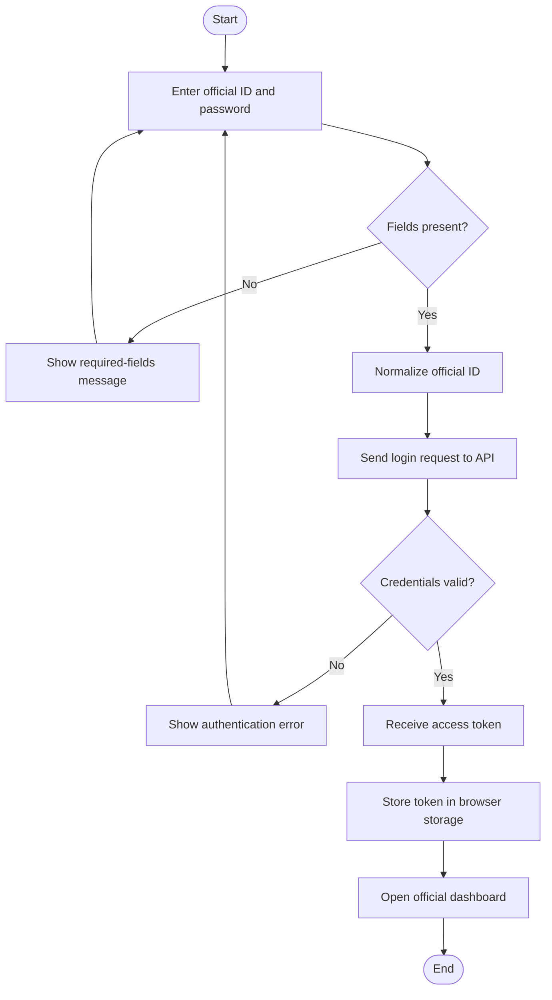
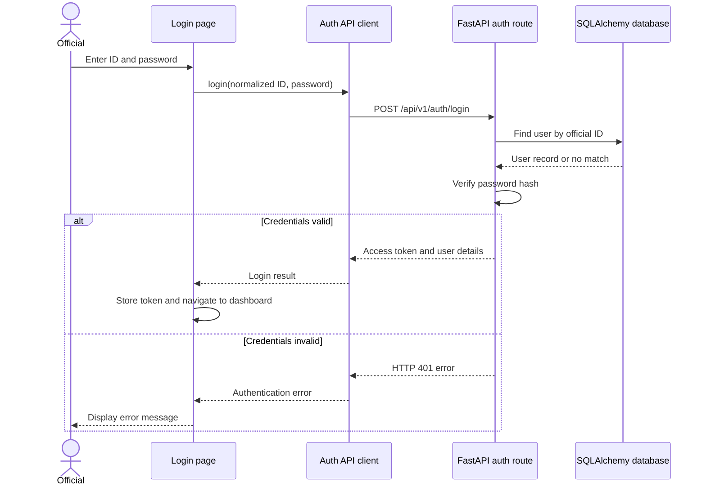
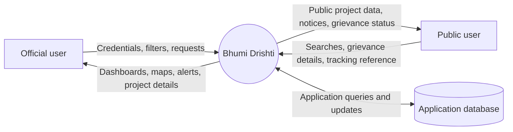
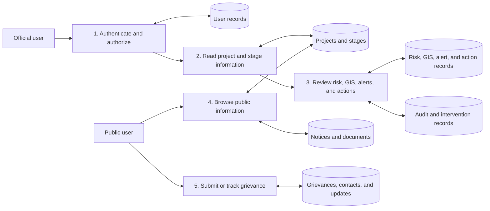
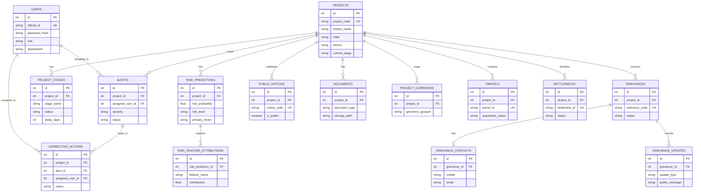

# Bhumi Drishti
## Project Report

> **Prototype notice:** This report describes the current Bhumi Drishti source code and its intended workflows. Demonstration screens and sample records use synthetic data; the application is not connected to official government systems. Feasibility estimates and hardware recommendations below are planning guidance, not measured production requirements.

## Abstract

*Land acquisition projects often experience delays because information about land records, compensation, rehabilitation, legal disputes, and project progress is fragmented across departments, making risks difficult to identify early. Bhumi Drishti addresses this problem through a digital land-acquisition intelligence platform that brings project information into a unified interface for public users and authorized officials. The solution provides project and milestone monitoring, district-level analytics, geospatial views, risk indicators, alerts, recommendations, audit history, and public grievance and notice features. Its web interface is built with Next.js, React, TypeScript, and Tailwind CSS, while a FastAPI backend exposes REST APIs, manages authentication using JWT, and accesses structured data through SQLAlchemy; PostgreSQL with PostGIS is supported for spatial data, with SQLite used for the bundled prototype database. The platform is designed to help officials review potential bottlenecks, prioritize follow-up, and improve visibility into project status, while giving citizens accessible project information and grievance tracking. The current prototype demonstrates these workflows using synthetic demo data and is not connected to official government systems. Its intended outcome is more transparent, coordinated, and proactive land-acquisition monitoring, supporting timely decisions and clearer communication among stakeholders.*

*Keywords: E-governance, spatial data infrastructure, civic technology, interdepartmental coordination, infrastructure delivery*

# CHAPTER 1: INTRODUCTION

## 1.1 Background of Study

Land acquisition for roads and other infrastructure involves multiple stages, records, organizations, and affected parties. Activities such as identifying parcels, verifying ownership, handling compensation, resettlement and rehabilitation, resolving disputes, and recording possession can progress at different rates. When information is kept in separate files or departmental systems, it can be difficult for project teams to see the overall status, identify dependencies, and communicate progress consistently.

Bhumi Drishti is a web-based prototype for presenting project, stage, risk, alert, geospatial, and public-facing information through one application. It has two broad interfaces: an official portal for project monitoring and administrative workflows, and a public portal for project information, notices, and grievance submission or tracking. The prototype is designed to demonstrate how structured project information and visual summaries might support coordination. It does not replace statutory records, legal processes, or existing government systems.

## 1.2 Problem Statement

Project stakeholders may lack a shared, up-to-date view of acquisition progress, parcel-level constraints, compensation and rehabilitation status, delays, and grievances. Fragmented information can make emerging bottlenecks harder to recognize, slow the assignment of follow-up actions, and limit public access to understandable project updates. A unified monitoring interface is therefore useful for exploring how project records, risk indicators, maps, alerts, and citizen-facing information could be organized together.

The current implementation is a prototype, not evidence that these operational challenges have been resolved in a live government environment. Its sample data are synthetic, and production integrations, data governance, and performance at scale remain outside the verified scope.

## 1.3 Objectives of the Project

The objectives of Bhumi Drishti are to:

1. Present land-acquisition projects, stages, and progress in a centralized interface.
2. Provide official users with project views, risk summaries, alerts, recommendations, and audit-oriented information.
3. Demonstrate map-based exploration of project corridors, parcels, and bottlenecks.
4. Provide a public-facing interface for project information, notices, and grievance workflows.
5. Define a backend API and relational data model for users, projects, risk information, alerts, GIS records, and grievances.
6. Demonstrate authenticated access to the official portal and document limitations that must be addressed before operational deployment.

## 1.4 Scope of the Project

### Included

- Next.js web application with official and public portal areas.
- Official login flow and token-based authentication API.
- Project portfolio and project-detail views.
- Dashboards and interfaces for risk monitoring, district analytics, recommendations, alerts, audit records, and model/data information.
- GIS views and data structures for corridors, parcels, and bottlenecks.
- Public project and notice views, grievance submission, and grievance tracking interfaces.
- FastAPI endpoints and SQLAlchemy models for the main domain entities.
- Synthetic data for demonstration and local testing.

### Not included or not verified

- Integration with live government identity, land-record, payment, court, or departmental systems.
- Official or personally identifiable land, parcel, or beneficiary data.
- A trained, validated, or independently evaluated predictive model. Risk values in the prototype are supplied as demonstration data or represented through existing records and predefined mappings.
- Statutory decision-making, legal verification, compensation disbursement, or automated approval.
- Production-grade security review, accessibility certification, high-availability deployment, or load testing.
- Verified native PostGIS geometry storage and spatial-query performance. GIS model geometries are represented as GeoJSON strings in the inspected models.

# CHAPTER 2: LITERATURE REVIEW / ANALYSIS

## 2.1 Related Work

Digital land-record and parcel-map initiatives provide relevant context for a project-monitoring system. For example, the National Informatics Centre's [Bhu-Naksha portal](https://bhunaksha.nic.in/bhunaksha/) describes a tool for parcel-map management by authorized state and union-territory officials. Such systems illustrate the importance of digitized parcel information and map-based access.

Bhumi Drishti has a related but distinct prototype focus: it brings project-stage monitoring, risk summaries, alerts, administrative follow-up, public notices, and grievance workflows into the same conceptual application as map views. It should be viewed as a complementary monitoring concept, not a replacement for official parcel-map or land-record systems. No integration with Bhu-Naksha or any other external platform is implemented or claimed.

Other relevant system patterns include:

- **Spreadsheet- and document-based tracking:** Flexible for small teams, but often requires manual reconciliation and does not inherently provide a shared map or live status view.
- **Project management information systems:** Organize milestones, responsibilities, and progress, but may not represent parcel geometry or acquisition-specific issues.
- **GIS and parcel-management applications:** Support spatial visualization and parcel-level records; their scope may not include cross-department project actions, public notices, and grievance tracking in one interface.
- **Public information and grievance portals:** Improve access to notices or case status, but may be separate from internal project-risk monitoring.

This is a functional comparison of system categories, not a systematic academic review or a head-to-head evaluation of named products. Before an academic submission, add institution-approved references and compare the project with systems selected by the supervisor.

## 2.2 Comparative Study

| Capability | Manual spreadsheets / documents | Parcel-map or GIS application | Bhumi Drishti prototype |
|---|---|---|---|
| Project and milestone overview | Possible, usually maintained manually | Often secondary to spatial records | Demonstrated in official project and dashboard views |
| Parcel and corridor visualization | Limited | Core capability | GIS interface and GeoJSON-oriented models are present |
| Risk, alerts, and recommendations | Usually requires separate processes | May be outside the core scope | Included as prototype screens, records, or predefined mappings |
| Public project information | Usually separate | Depends on the specific application | Public project and notice views are provided |
| Grievance intake and tracking | Separate registers or systems may be used | Usually not the main focus | Public submission and tracking workflows are represented |
| Live external-system integration | Not inherent | Depends on implementation | Not implemented or verified |
| Evidence of predictive accuracy | Not applicable | Not applicable | No validated predictive model or accuracy study is provided |

The prototype's principal contribution is the unified user experience across project monitoring, GIS-oriented views, and public workflows. Its current data and integration limitations prevent a claim that it outperforms operational systems.

## 2.3 Feasibility Study

### Technical Feasibility

The application uses established web technologies: Next.js, React, and TypeScript for the frontend; FastAPI and SQLAlchemy for the backend; and PostgreSQL/PostGIS as the documented database target. A bundled SQLite database supports the local prototype. The backend is organized into route, schema, model, and database layers, and Alembic migration files are present.

The implementation is technically feasible as a demonstrator. Reproducible backend setup needs work: the repository documentation refers to a Python requirements file and an example environment file that are not present in the inspected project tree. The backend also requires database URLs and a JWT secret from configuration. These items should be completed before onboarding another developer or deploying the backend.

### Economic Feasibility

The prototype can be developed and demonstrated using open-source frameworks and locally hosted services. This reduces initial software-license costs but does not make production operation cost-free. A real deployment would require costs for infrastructure, backups, monitoring, security assessment, data migration, support, user training, and integrations. No implementation budget or total-cost-of-ownership study has been prepared; financial feasibility must be assessed against the intended deployment scale and government procurement requirements.

### Operational Feasibility

The separate official and public interfaces align with two broad user groups. Dashboards, filters, map views, notices, and grievance forms provide recognizable interaction patterns. For operational use, departments would need agreed data ownership, update responsibilities, access roles, escalation procedures, grievance service levels, records-retention rules, and staff training. User acceptance and accessibility testing with actual officials and affected communities have not been conducted.

# CHAPTER 3: SYSTEM DESIGN

## 3.1 System Architecture

The application follows a client/API/database design. The browser renders the Next.js application. Frontend API service modules send HTTP requests to the FastAPI backend. The backend validates requests, applies route logic, verifies credentials or bearer tokens where required, and uses SQLAlchemy to query or update the configured database.

The diagram distinguishes the bundled SQLite prototype database from the documented PostgreSQL/PostGIS deployment target. The current GIS model fields inspected in the source use string-based GeoJSON representations; the diagram must not be interpreted as evidence that native PostGIS spatial queries are implemented.

## 3.2 UML Diagrams

### Use Case Diagram

This diagram summarizes intended portal use cases. It does not imply that every screen is connected to persistent backend data or that administrative configuration has a user interface.

### Activity Diagram: Official Login

### Sequence Diagram: Official Login

## 3.3 Data Flow Diagram (DFD)

### Context Diagram (Level 0)

### Level 1

The public and official flows are represented by API routes and frontend pages in the codebase. The degree to which each screen reads or writes persistent records varies by module.

## 3.4 ER Diagram

The ER diagram focuses on the core foreign-key relationships represented in the ORM models. `RiskHistory`, `RiskDimension`, `DataQuality`, `Case`, and `Intervention` are additional tables. Some of these refer to projects by `project_code` without a database foreign key, so their association is logical rather than enforced by the schema.

## 3.5 Database Design

The SQLAlchemy models define the following main entities:

| Entity group | Tables | Purpose |
|---|---|---|
| Identity | `users` | Official identifier, password hash, role, department, and location attributes |
| Projects | `projects`, `project_stages` | Project profile, location attributes, progress, and stage history |
| Risk and quality | `risk_predictions`, `risk_feature_attributions`, `risk_history`, `risk_dimensions`, `data_quality` | Stored risk summaries, feature contributions, time series, risk dimensions, and data-quality indicators |
| Operations | `alerts`, `corrective_actions`, `cases`, `interventions`, `audit_events` | Follow-up items, cases, recorded interventions, and audit events |
| Public workflows | `public_notices`, `documents`, `grievances`, `grievance_contacts`, `grievance_updates` | Published information and grievance intake/status history |
| GIS | `project_corridors`, `parcels`, `bottlenecks` | Project-related spatial records and their acquisition/risk attributes |

The schema uses integer primary keys and string business identifiers such as project codes, alert codes, and grievance reference codes. Foreign keys connect core project, stage, risk-prediction, alert, grievance, notice, and GIS records. Several frequently queried business identifiers and status/location fields are indexed in the models.

PostgreSQL with PostGIS is the documented deployment target, while the repository includes a SQLite database for the demonstration. The models store several geometries as strings containing GeoJSON and represent project location as a string; the current schema therefore does not demonstrate native PostGIS geometry columns, spatial indexes, or spatial query operators.

# CHAPTER 4: IMPLEMENTATION

## 4.1 Tools & Technologies Used

| Technology | Use |
|---|---|
| Next.js 16 and React 19 | Web application and component-based user interface |
| TypeScript | Frontend type checking |
| Tailwind CSS | Utility-based UI styling |
| Recharts | Dashboard charts |
| Leaflet and React-Leaflet | Map presentation |
| FastAPI | Python REST API |
| Pydantic | API request/response schemas and settings |
| SQLAlchemy | Database ORM and asynchronous database access |
| Alembic | Database migration scripts |
| PostgreSQL / PostGIS | Documented target for persistent and spatial data |
| SQLite | Bundled local prototype database |
| JWT and bcrypt-compatible password hashing | Token-based authentication and password verification |
| Docker Compose | Local PostgreSQL/PostGIS service configuration |

## 4.2 System Requirements

The following are practical development recommendations, not measured minimums.

### Hardware

| Component | Recommended development setup |
|---|---|
| Processor | 4 CPU cores or better |
| Memory | 8 GB RAM or more; additional memory is helpful when running the frontend, backend, and database together |
| Storage | 5 GB free for source, dependencies, and local database; more for development caches |
| Network | Internet access for dependency installation; local application use works through localhost |

Production hardware must be sized using expected user concurrency, database size, map workload, availability requirements, and measured load tests.

### Software

- A supported operating system with Node.js compatible with Next.js 16 and npm.
- Python 3.10 or later, as specified by the backend README.
- PostgreSQL with PostGIS and Docker, if using the documented database setup; the bundled SQLite database can support limited local demonstration.
- A modern browser such as a current version of Chrome, Firefox, Safari, or Edge.
- Environment variables for database URLs and a strong JWT signing secret.

The repository currently lacks the backend dependency manifest and example environment file referenced by its setup documentation. Backend dependencies and environment setup should be made reproducible before treating these as complete installation instructions.

## 4.3 Modules Description

1. **Public landing and project information:** Presents public-facing project discovery and general information.
2. **Official authentication:** Sends credentials to the backend, receives a bearer token, and stores the token for the browser session workflow. The current official layout checks for token presence on protected paths.
3. **Project portfolio and details:** Provides project lists, filters, project detail pages, and milestone-oriented information.
4. **Dashboard and district analytics:** Displays summaries, charts, geographic or district filters, and items requiring attention.
5. **Risk monitoring and risk engine:** Presents risk levels, drivers, trajectories, dimensions, and reliability-oriented information. The prototype does not include evidence of a trained model pipeline.
6. **GIS intelligence:** Presents project map interfaces and supports corridor-, parcel-, and bottleneck-oriented data structures.
7. **Alerts, recommendations, and actions:** Displays alert severity/status and possible follow-up actions. Some recommendation content is based on predefined mappings and synthetic data.
8. **Audit and model/data views:** Presents audit-oriented records and prototype data/model metadata.
9. **Public notices:** Displays public information associated with projects.
10. **Grievance submission and tracking:** Collects grievance information and provides a reference-based tracking interface; backend routes and database models support the concept.

Not every screen is connected to the backend in the same way. Some pages use local fixtures or predefined demonstration data, while selected project, GIS, public, and authentication workflows call API services.

## 4.4 Algorithms / Logic Used

- **Authentication:** The backend looks up an official account by identifier, verifies the submitted password against its stored hash, and returns a signed JWT when authentication succeeds. Invalid credentials produce an HTTP 401 response. The login form normalizes the identifier to uppercase to accommodate case differences in the demo account.
- **Token handling:** The frontend stores the returned token in browser `localStorage` and attaches it as a bearer token to API requests. The official layout checks whether a token exists before rendering non-login official pages.
- **Project and stage access:** API routes use SQLAlchemy queries to retrieve project records, stage records, and related information. The UI applies filters and displays project status.
- **Risk presentation:** Risk probability, category, primary driver, feature attribution, history, and dimension fields are represented in the schema. The prototype shows risk summaries and predefined or synthetic examples; a validated predictive algorithm, training data pipeline, threshold study, and model evaluation are not present in the inspected repository.
- **Recommendations and alerts:** Recommendation text and alert records are surfaced for review. Where the UI uses predefined mappings, outputs should be treated as demonstrative guidance rather than official or automatically generated directives.
- **GIS presentation:** The frontend uses map components and GIS-oriented project data. The current models represent geometries as GeoJSON strings; no evidence of spatial-index-based computation is claimed.

# CHAPTER 5: TESTING & RESULTS

## 5.1 Test Plan

Testing should cover the following layers:

1. **Unit tests:** Validate password verification, input normalization, risk/display transformations, and schema validation.
2. **API tests:** Check successful and unsuccessful authentication, public project/notice access, grievance flows, protected endpoints, and expected response formats.
3. **Database tests:** Use an isolated test database to validate foreign keys, uniqueness, migrations, and transaction behavior.
4. **UI tests:** Validate form errors, successful login, protected-route behavior, project filters, map rendering, and public grievance flows.
5. **Integration tests:** Exercise complete browser-to-API workflows using a controlled synthetic dataset.
6. **Performance and security tests:** Measure response time and throughput under representative load; review secrets, access controls, CORS, token storage, data exposure, and backup/recovery procedures.
7. **User acceptance tests:** Review clarity and accessibility with representative public users and officials before operational use.

## 5.2 Test Cases

| ID | Test case | Expected result | Recorded result |
|---|---|---|---|
| TC-01 | Request `/api/health` | HTTP 200 and health response | Passed during local verification |
| TC-02 | Submit the configured demo account with the updated credentials | HTTP 200 with an access token and user details | Passed during local verification |
| TC-03 | Enter the demo identifier in lowercase in the official login form | Frontend normalizes the identifier and login succeeds | Passed in the local browser |
| TC-04 | Submit incorrect credentials | HTTP 401 and a visible login error | HTTP 401 observed during local verification |
| TC-05 | Open a protected official page without a stored token | Redirect to official login | Not independently tested as a formal test |
| TC-06 | Submit a public grievance and retrieve it by reference | Persisted submission and matching tracking result | Not formally tested end-to-end |
| TC-07 | Run project/GIS endpoints against PostgreSQL/PostGIS | Correct data and spatial behavior | Not verified against a production-style PostgreSQL/PostGIS deployment |
| TC-08 | Run concurrent users and large map/project queries | Meet agreed latency and throughput targets | Not load-tested |

The existing backend test file contains a health-check assertion, but its login and project test functions are stubs. The test suite therefore does not currently provide comprehensive automated coverage.

## 5.3 Output Screenshots

Insert actual screenshots from the running application in the final submission. Do not use mock images as evidence of tested functionality.

- **Figure 5.1:** Public landing page — `[Insert screenshot of /public]`
- **Figure 5.2:** Official login page — `[Insert screenshot of /official/login; hide any credentials]`
- **Figure 5.3:** Official project dashboard — `[Insert screenshot of /official/dashboard]`
- **Figure 5.4:** GIS intelligence view — `[Insert screenshot of /official/gis]`
- **Figure 5.5:** Public grievance submission or tracking — `[Insert screenshot of the relevant public page]`

Use synthetic records only in screenshots. Remove browser tokens, personal information, passwords, and environment details before sharing.

## 5.4 Performance Analysis

No controlled performance benchmark, load test, or production-scale evaluation has been conducted. Local development verification confirmed that the API health endpoint responded successfully and that the demo login flow could return a token. These checks establish basic functional reachability only; they do not establish response-time guarantees, capacity, availability, or behavior under concurrent load.

Before deployment, define measurable targets for API latency, page-load time, map rendering, concurrent users, database query time, and error rate. Test with representative synthetic datasets and record the hardware, dataset size, network conditions, concurrency, and measurement method. Results should be reported only after those tests are run.

# CHAPTER 6: CONCLUSION & FUTURE WORK

## Summary of Project

Bhumi Drishti is a web-based prototype that brings together official project-monitoring concepts and public-facing information workflows for land acquisition. It combines project and stage views with risk-oriented screens, GIS interfaces, alerts, public notices, and grievance workflows. The application uses a Next.js frontend and a FastAPI/SQLAlchemy backend, with a bundled SQLite database for demonstration and PostgreSQL/PostGIS documented as a deployment target.

## Achievements

- Established separate public and official portal experiences.
- Implemented a backend login endpoint with password-hash verification and JWT issuance.
- Defined data models for projects, stages, risk, alerts, actions, grievances, notices, audit records, and GIS-related entities.
- Built dashboard, project, analytics, risk, map, and grievance interface prototypes.
- Verified basic local API health and demo login behavior.
- Documented where synthetic content, incomplete integration, and missing validation limit the conclusions that can be drawn.

## Limitations

- Demonstration content is synthetic and cannot establish real-world operational impact.
- External identity, land-record, payment, court, and departmental integrations are not implemented.
- Several frontend modules use local fixtures or predefined values rather than end-to-end live backend data.
- No trained and validated risk-prediction pipeline or accuracy evaluation is provided.
- GIS geometry is represented as text/GeoJSON in the inspected models; native PostGIS querying is not verified.
- Automated backend tests are limited; login and project test functions are stubs.
- The repository setup is not fully reproducible because the documented Python dependency and example environment files are missing.
- Production security, accessibility, backup, availability, and performance testing remain outstanding.
- Demo credentials are for local prototype use only and must not be used for real accounts or production deployment.

## Future Scope

1. Add complete backend dependency and environment manifests and document a clean setup path.
2. Replace demonstration data with approved, quality-checked data sources under appropriate data-sharing agreements.
3. Implement secure, role-based access control on the backend, account lifecycle management, and production secrets management.
4. Integrate with authorized land-record and GIS services, using native spatial types and indexes where appropriate.
5. Complete end-to-end persistence for project, alert, recommendation, notice, and grievance workflows.
6. Define risk indicators transparently; if machine learning is introduced, document the dataset, validation methodology, bias checks, uncertainty, and human oversight.
7. Add automated unit, API, database, UI, and integration tests using isolated test fixtures.
8. Conduct accessibility and usability reviews with representative officials and public users.
9. Perform security assessment, load testing, backup/recovery exercises, and deployment monitoring.
10. Evaluate the prototype through a supervised pilot and measure outcomes such as data freshness, issue-resolution time, and user task completion.

## References

1. National Informatics Centre, Government of India. **Bhu-Naksha: About Bhu-Naksha.** <https://bhunaksha.nic.in/bhunaksha/> (accessed 25 November 2026).
2. Bhumi Drishti project source code and backend README. Local prototype documentation and implementation, accessed 25 November 2026.
3. Next.js documentation. <https://nextjs.org/docs>
4. FastAPI documentation. <https://fastapi.tiangolo.com/>
5. SQLAlchemy documentation. <https://docs.sqlalchemy.org/>
6. PostgreSQL documentation. <https://www.postgresql.org/docs/>
7. PostGIS documentation. <https://postgis.net/documentation/>
